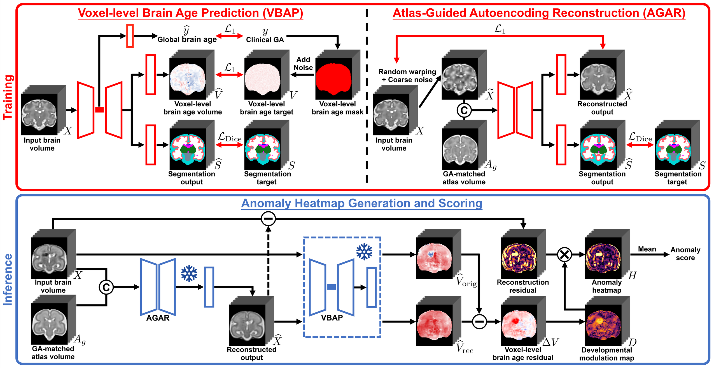

# FetalBUAD

**Unsupervised anomaly detection in fetal brain MRI**

[Inputs](#prepare-the-inputs) · [Train the two networks](#train-the-two-networks) · [Score an examination](#score-an-examination)

FetalBUAD asks two questions about a fetal brain MRI. Which structures differ from an atlas-guided reconstruction? Where do the original and reconstructed images give different estimates of local brain age? The model combines these signals into a three-dimensional anomaly map and a single score per examination.



| Branch | Training signal | Role at inference |
| --- | --- | --- |
| **Voxel-level brain age prediction (VBAP)** | Gestational age, voxel-age targets and nine-class tissue segmentation | Compares the voxel-age maps of the MRI and its reconstruction. Both positive and negative local changes contribute. |
| **Atlas-guided autoencoding reconstruction (AGAR)** | Reconstruction of clean MRI from a corrupted input and a gestational-age-matched atlas, with auxiliary tissue segmentation | Produces a reference image for the absolute reconstruction error map. |

## Prepare the inputs

Install the Python dependencies from the repository root. Use a CUDA-enabled PyTorch build to train on a GPU.

```sh
python -m pip install -r requirements.txt
```

Supply your own normal training and validation examinations and weekly atlases. Training takes CSV manifests. Paths in each CSV are relative to the directory containing that CSV. Gestational age is expressed in **weeks** and may include a fractional week.

```csv
image,segmentation,age_weeks
../images/example.nii.gz,../labels/example.nii.gz,29.5
```

| Input | Expected representation |
| --- | --- |
| MRI and tissue labels | Aligned on the same **128 × 160 × 128** voxel grid. Tissue labels are integers 0–8, including background. Use separate examinations for training and validation. |
| Brain-age training MRI | Aligned, cropped MRI with zero background and positive foreground. The loader standardizes foreground intensities and converts the age target to days. |
| Reconstruction MRI and atlases | Aligned and cropped on the same grid. Scale each volume using its positive-foreground 1st and 99th percentiles, clip to [0, 1], and keep the background at zero. These are also the intensity units for inference. |
| Atlas directory | Name the gestational-week files `week_21.nii.gz` through `week_38.nii.gz`. The nearest week is selected, with half weeks rounded up and out-of-range ages assigned to the closest endpoint. |
| Inference masks | Supply the whole-brain scoring mask on the MRI grid. An optional aligned foreground mask sets the region used to standardize the MRI and center the age difference. The default is the intersection of the brain mask with positive MRI voxels. |

The volume loaders accept NIfTI (`.nii`, `.nii.gz`) and NumPy (`.npy`) files in native array order. Keep the affine consistent across NIfTI inputs.

## Train the two networks

Both networks learn from normal examinations and can be trained independently. Use manifests pointing to the corresponding prepared images for each branch.

**1 · Train the voxel-level brain-age predictor**

```sh
python -m fetalbuad.age --train splits/age_train.csv --val splits/age_val.csv --output checkpoints/age.pt
```

**2 · Train the atlas-guided reconstruction network**

```sh
python -m fetalbuad.reconstruction --train splits/recon_train.csv --val splits/recon_val.csv --atlas-dir data/atlases --output checkpoints/reconstruction.pt
```

The upper-right panel of the original figure labels the reconstruction loss as L1. The training code uses **foreground mean squared error** plus a tissue Dice loss weighted by 0.01. Absolute reconstruction error is used when generating the inference heatmap.

## Score an examination

```sh
python -m fetalbuad.inference --image data/exam/mri.nii.gz --mask data/exam/brain.nii.gz --age-weeks 29.5 --atlas-dir data/atlases --age-checkpoint checkpoints/age.pt --recon-checkpoint checkpoints/reconstruction.pt --output results/example
```

If preprocessing provides a separately aligned MRI foreground, pass it with `--foreground data/exam/foreground.nii.gz` to reproduce that foreground definition. The case score still uses the complete scoring mask.

| Output | Meaning |
| --- | --- |
| `H_rec` | Absolute difference between the input and reconstructed MRI within the brain mask. |
| `H_age` | Magnitude of the locally centered change between the two voxel-age predictions, mapped to [0.5, 1] within the brain mask. |
| `H_final` | Voxel-wise product of the reconstruction error and brain-age maps. |
| `score.json` | Mean of the fused map over all voxels in the whole-brain scoring mask. |

Map outputs are NIfTI volumes when a NIfTI image or mask supplies the spatial frame, and NumPy arrays for an all-NumPy examination. Use `--help` with any module to see the available arguments.
